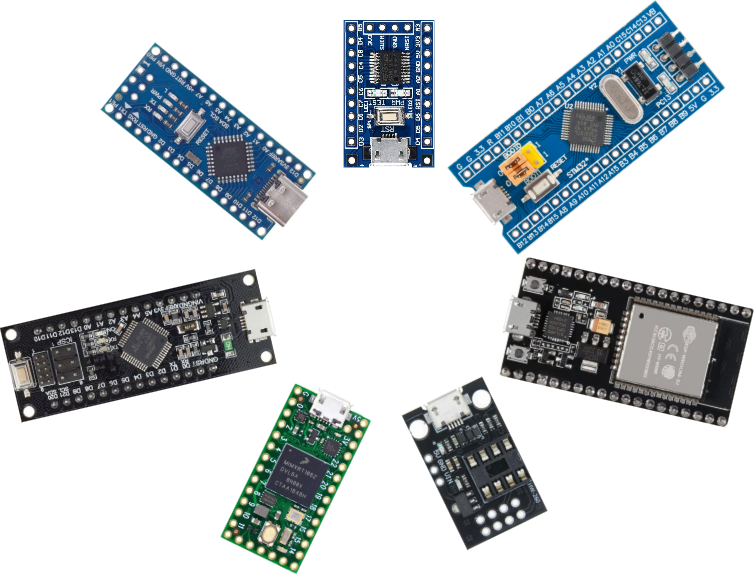
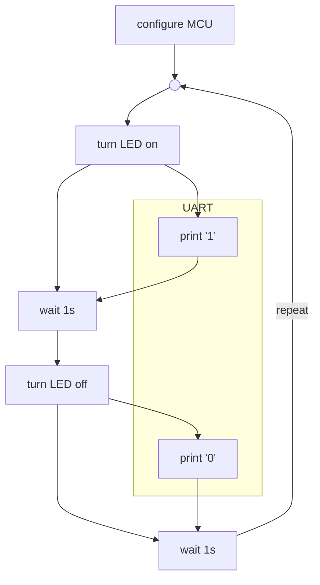

# Embedded Compile and Upload <!-- omit from toc -->

A collection of tools and descriptions for compiling and uploading firmware for the more used microcontroller families

Every variant has tools and documentation to do these actions:

1. **Compile**: Compile source code into one or more binary file(s)
2. **Upload**: Upload the compiled binary file(s) onto the microcontroller
3. **Debug**: Debug the uploaded firmware

## Common firmware

For simplicity, the same program is used for each variant, which is the classic **blink** program. If the variant has an UART available, the current LED state will be printed to it.

